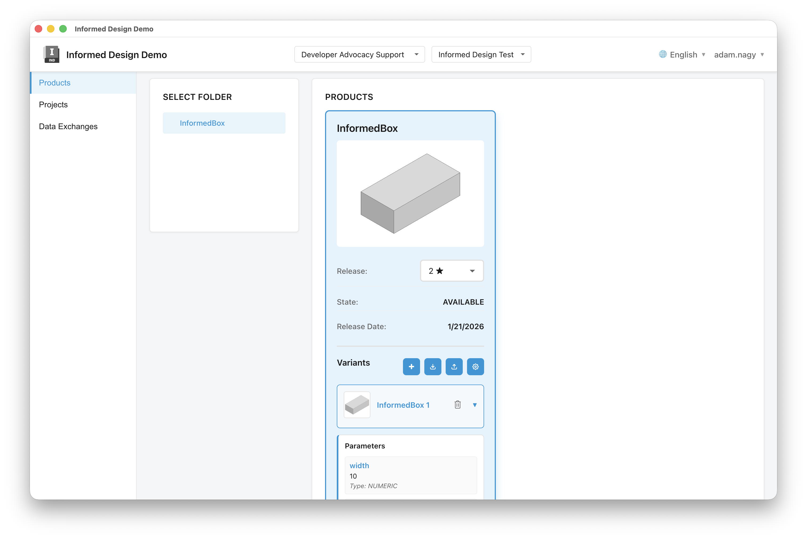
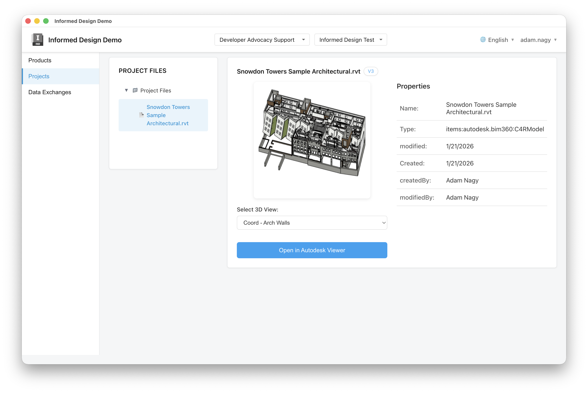
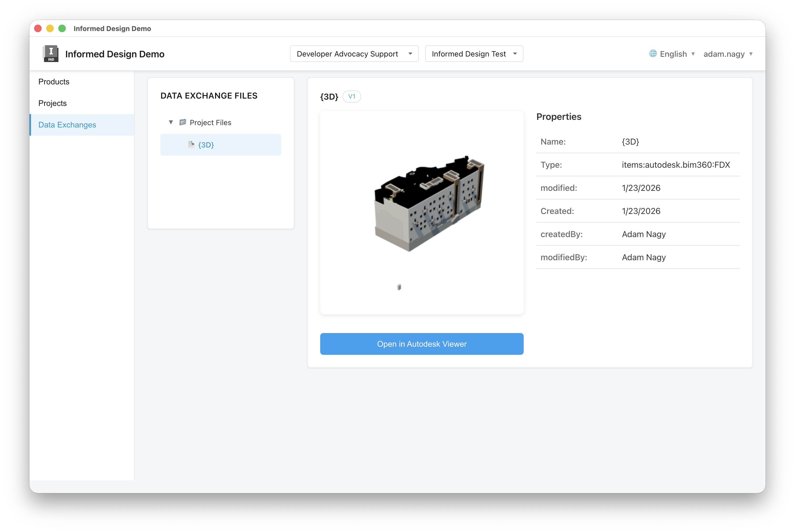
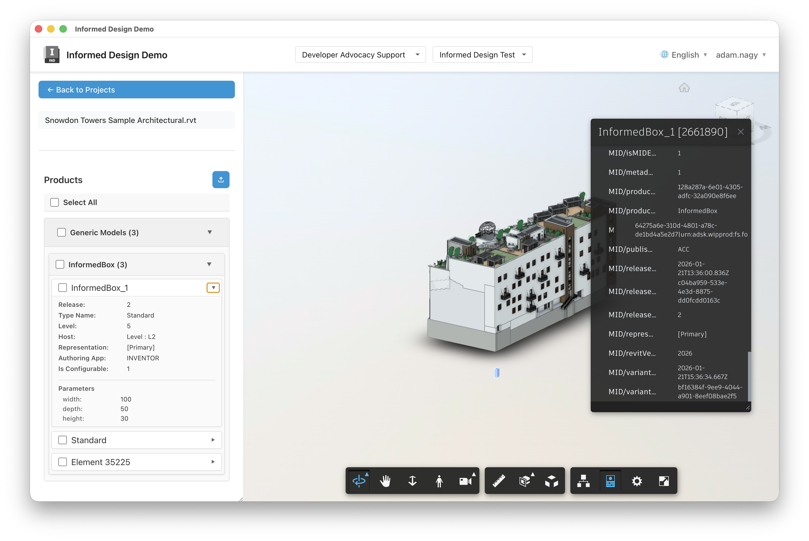

# Informed Design Demo Application

A demonstration application showcasing how to work with the **Autodesk Informed Design APIs**. This full-stack application (Node.js backend + React.js frontend) provides a complete example of integrating with Informed Design to access and manage accounts, projects, folders, products, releases, and variants.

Products


Projects


Data Exchanges


View models


## Overview

This demo application illustrates key patterns and best practices for working with the Informed Design APIs, including:

- **Authentication**: 3-legged OAuth (3LO) authentication with Autodesk Platform Services (APS)
- **Account Management**: Accessing and displaying user accounts
- **Project & Folder Navigation**: Browsing projects and folders within accounts
- **Product Management**: Viewing products, releases, and variants
- **Data Visualization**: Displaying product information, thumbnails, and metadata
- **File Downloads**: Downloading variant output files

The application uses 3-legged OAuth authentication as part of the setup, but the primary focus is demonstrating how to interact with Informed Design APIs to build applications that work with product data.

## Project Structure

```
.
├── backend/          # Node.js Express server
│   ├── server.js     # Main server file with Informed Design API routes
│   └── package.json  # Backend dependencies
├── frontend/         # React.js application
│   ├── src/          # React source files
│   │   ├── App.js    # Main application component with Informed Design integration
│   │   └── components/ # UI components
│   ├── public/       # Public assets
│   └── package.json  # Frontend dependencies
└── electron/         # Electron desktop app configuration
    ├── main.js       # Electron main process
    └── preload.js    # Preload script for secure IPC
```

## Prerequisites

- Node.js (v16 or higher)
- npm (v7 or higher)
- Autodesk Platform Services (APS) account and application credentials

## APS Setup

1. **Create an APS Application**:
   - Go to [APS Developer Portal](https://aps.autodesk.com/myapps)
   - Create a new application
   - Note your **Client ID** and **Client Secret**

2. **Configure Redirect URI**:
   - In your APS application settings, set the **Callback URL** to:
     - `http://localhost:3000` (for development)
     - Or your production URL

## Setup Instructions

### Backend Setup

1. Navigate to the backend directory:
```bash
cd backend
```

2. Install dependencies:
```bash
npm install
```

3. Create a `.env` file or rename `.env.template` and fill in your APS credentials:
```bash
APS_CLIENT_ID=your_client_id_here
APS_CLIENT_SECRET=your_client_secret_here
APS_REDIRECT_URI=http://localhost:3000
```

4. Start the server:
```bash
# Development mode with auto-reload
npm run dev

# Production mode
npm start
```

The backend server will run on `http://localhost:8080`

### Frontend Setup

1. Navigate to the frontend directory:
```bash
cd frontend
```

2. Install dependencies:
```bash
npm install
```

3. Start the development server:
```bash
npm start
```

The frontend application will run on `http://localhost:3000` (configured to match APS callback URL) and automatically open in your browser.

### Electron Desktop App

The application can also be built as a standalone Electron desktop application:

1. Build the application:
```bash
npm run build
```

2. The built application will be in the `dist/` directory as a DMG file (macOS) or installer for your platform.

The Electron app provides the same functionality as the web version but runs as a native desktop application with improved OAuth handling across different origins.

## Features

### Informed Design API Integration

- **Account Access**: Browse and select Autodesk accounts
- **Project Navigation**: Navigate through projects and folders
- **Product Discovery**: View products within folders with metadata
- **Release Management**: Access product releases and their details
- **Variant Exploration**: Browse variants within releases
- **File Downloads**: Download variant output files
- **ID Management**: View and copy all relevant IDs (Account, Project, Folder, Product, Release, Variant)

### Backend API Endpoints

- `GET /health` - Health check endpoint
- `GET /api/aps/config` - Get APS configuration for OAuth
- `POST /api/aps/token` - Exchange authorization code for access token (3LO)
- `GET /api/acc/accounts` - Get user's accounts
- `GET /api/acc/accounts/:accountId/projects` - Get projects for an account
- `GET /api/acc/projects/:projectId/folders` - Get folders for a project
- `GET /api/informed-design/projects/:projectId/folders/:folderId/products` - Get products in a folder
- `GET /api/informed-design/releases` - Get releases for a product
- `GET /api/informed-design/variants` - Get variants for a release
- `GET /api/informed-design/variants/:variantId/output` - Download variant output file

### Frontend Features

- Clean, modern UI with Autodesk branding
- 3-legged OAuth 2.0 authentication with APS
- Hierarchical navigation (Accounts → Projects → Folders → Products → Releases → Variants)
- Product and variant thumbnails
- Token and ID dialogs for debugging and reference
- Secure token management
- Electron desktop app support

## Authentication

This application uses **3-legged OAuth (3LO)** authentication with Autodesk Platform Services to securely authenticate users and access Informed Design APIs. The authentication flow is a necessary prerequisite for working with Informed Design APIs, as it provides user-specific access tokens required for API calls.

### Authentication Flow:

1. **User initiates login**: User clicks "Login with Autodesk" button
2. **Authorization request**: User is redirected to Autodesk's authorization page
3. **User authentication**: User logs in with their Autodesk credentials and grants permissions
4. **Authorization code**: After authentication, Autodesk redirects back with an authorization code
5. **Token exchange**: Frontend sends the code to the backend `/api/aps/token` endpoint
6. **Secure token exchange**: Backend securely exchanges the code for an access token (server-side only)
7. **Token storage**: Access token is stored and used for subsequent Informed Design API calls

### Why 3-Legged OAuth?

- **User-specific access**: Access tokens represent the authenticated user, required for accessing their Informed Design data
- **Secure**: Client secret never exposed to the frontend
- **Required for Informed Design**: All Informed Design API endpoints require authenticated user tokens

## Development

The frontend is configured to proxy API requests to the backend server (see `package.json` proxy setting). This means you can make requests to `/api/*` from the frontend, and they will be automatically forwarded to `http://localhost:8080`.

## Security Notes

- Client secret is never exposed to the frontend (token exchange happens server-side)
- All user inputs are validated and sanitized
- Environment variables are used for sensitive credentials
- CORS is properly configured
- Access tokens are stored in localStorage (consider using httpOnly cookies for production)
- Input validation prevents injection attacks

## License

This project is licensed under the MIT License. See the LICENSE file for details.

